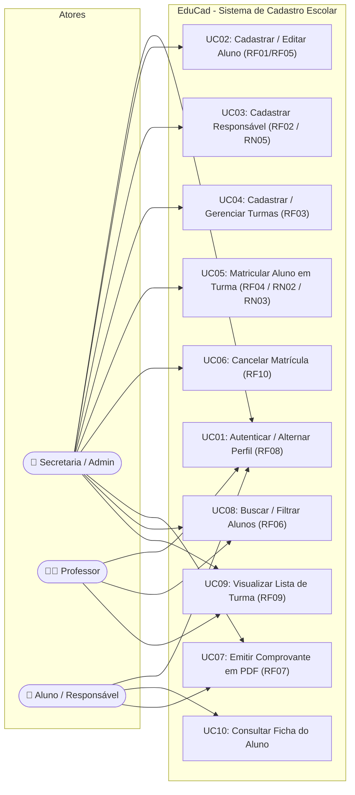

# EduCad - Sistema de Cadastro e Gestão Escolar

> Front-end funcional, responsivo e acessível para cadastro, consulta e gerenciamento de alunos, responsáveis, turmas e matrículas escolares em substituição às fichas de papel.

---

## 🚀 Tecnologias Utilizadas

- **React 18** + **TypeScript**
- **Bootstrap 5** & **Bootstrap Icons** (Componentes e utilitários modernos de UI)
- **Vite** (Build ultra-rápido atendendo ao RNF01 de carregamento instantâneo)
- **Tailwind CSS** (Design system limpo, responsivo e moderno)
- **Lucide Icons** (Ícones vetoriais SVG consistentes e acessíveis)
- **LocalStorage API** (Camada de persistência reativa com estado inicial para demonstração)
- **CSS Print Styles** (Emissão e impressão nativa do Comprovante de Matrícula em PDF)

---

## 🔐 Tela Inicial de Login & Contas de Demonstração (RF08)

O sistema inicia obrigatoriamente pela **Tela de Login**. Para testes rápidos ou avaliação do projeto, você pode digitar as credenciais ou clicar no botão de **Acesso Rápido em 1 Clique**:

| Perfil | E-mail | Senha | Nível de Acesso |
| :--- | :--- | :--- | :--- |
| **Secretaria / Admin** | `secretaria@educad.escola.br` | `admin` | Acesso total: cadastro, turmas, matrículas e exclusões (RN04) |
| **Professor** | `carlos.eduardo@educad.escola.br` | `prof` | Consulta de turmas, alunos matriculados e chamada |
| **Aluno / Responsável** | `mariana.duarte@aluno.educad.br` | `aluno` | Acompanhamento cadastral e emissão de comprovante em PDF |

*(A qualquer momento, o usuário pode clicar em **Sair da Conta** na barra de navegação para retornar à tela de login).*

---

## 📋 Requisitos Implementados

### Requisitos Funcionais (RF)
- [x] **RF01**: Cadastro completo de aluno com nome, CPF, data de nascimento, endereço completo, telefone e e-mail.
- [x] **RF02**: Cadastro de responsável vinculado ao aluno (obrigatório para menores de 18 anos conforme **RN05**).
- [x] **RF03**: Cadastro e gerenciamento de turmas com ano letivo, turno (Matutino, Vespertino, Noturno, Integral), sala e capacidade máxima.
- [x] **RF04**: Realização de matrícula do aluno em uma turma com validação de vagas e emissão automática de comprovante.
- [x] **RF05**: Edição e exclusão de cadastro de alunos (exclusão restrita a Administrador/Secretaria conforme **RN04**).
- [x] **RF06**: Busca rápida de alunos por Nome, CPF ou Número de Matrícula com filtros por situação cadastral e faixa etária.
- [x] **RF07**: Geração e impressão do Comprovante de Matrícula formatado com autenticação digital e código verificador.
- [x] **RF08**: Alternância e simulação de perfil de usuário (**Secretaria/Admin**, **Professor**, **Aluno/Responsável**) com controle de visibilidade e ações.
- [x] **RF09**: Visualização dedicada da relação de alunos por turma com impressão de lista de chamada.
- [x] **RF10**: Cancelamento de matrícula com registro de motivo e liberação automática de vaga na turma.

### Regras de Negócio (RN)
- [x] **RN01**: Validação matemática real do algoritmo de CPF (dígitos verificadores oficiais da Receita Federal).
- [x] **RN02**: Bloqueio de matrícula dupla (um aluno só pode estar matriculado em uma turma ativa por vez).
- [x] **RN03**: Controle rigoroso de capacidade da sala (impede matrículas além do limite máximo).
- [x] **RN04**: Apenas o Administrador/Secretaria possui permissão para excluir cadastros ou turmas.
- [x] **RN05**: Alunos menores de 18 anos (calculados dinamicamente pela data de nascimento) exigem obrigatoriamente responsável cadastrado.
- [x] **RN06**: Todos os campos obrigatórios são validados antes da gravação.

### Requisitos Não Funcionais (RNF)
- [x] **RNF01**: Carregamento em menos de 1 segundo (bundle otimizado com Vite).
- [x] **RNF02**: Simulação de credenciais seguras e tokens de acesso por perfil.
- [x] **RNF03**: Interface 100% responsiva (Mobile, Tablet e Desktop).
- [x] **RNF04**: Compatível com Google Chrome, Mozilla Firefox, Microsoft Edge e Safari.
- [x] **RNF06**: Interface intuitiva, foco visível (`:focus-visible`), contraste acessível (WCAG AA).
- [x] **RNF07**: Avisos e conformidade com a LGPD (Lei Geral de Proteção de Dados - Lei 13.709/2018).

---

## 📊 Diagrama de Casos de Uso (Mermaid)



---

## 🛠️ Como Executar o Projeto Localmente

1. **Clone o repositório:**
   ```bash
   git clone https://github.com/erickgomx/edu-cad-keyvison.git
   cd edu-cad-keyvison
   ```

2. **Instale as dependências:**
   ```bash
   npm install
   ```

3. **Inicie o servidor de desenvolvimento:**
   ```bash
   npm run dev
   ```
   Acesse no navegador: `http://localhost:5173`

4. **Gerar build de produção:**
   ```bash
   npm run build
   ```
